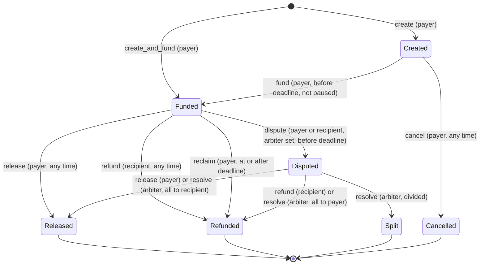

# sisonke-escrow contract reference

One Soroban contract holds every Sisonke escrow and all locked USDC. This page is the
reference for the web app, for reviewers and for anyone deciding whether to trust an
escrow: **who can move the money, and when**. The design record is [PLAN.md](PLAN.md),
upgrades are covered in [UPGRADES.md](UPGRADES.md), and the security review is [AUDIT.md](AUDIT.md).

| | |
|---|---|
| Network | Stellar Testnet |
| Contract | `NEXT_PUBLIC_SISONKE_CONTRACT_ID` in `deployments/testnet.env` (written by `scripts/deploy.sh`, with the deploy tx and wasm hash); every e2e transaction is linked in [TRANSACTIONS.md](TRANSACTIONS.md) |
| Token | Circle Testnet USDC SAC `CBIELTK6YBZJU5UP2WWQEUCYKLPU6AUNZ2BQ4WWFEIE3USCIHMXQDAMA`, pinned at construction |
| Version | `version() == 1`, `storage_version() == 1` |
| Upgrades | Enabled, UUPS-style, **instant**, until `lock_upgrades` (see below) |
| Source | [`contracts/sisonke-escrow/src`](../contracts/sisonke-escrow/src) |
| SDK | `soroban-sdk` 29.0.1, Rust 1.99.1, target `wasm32v1-none` |

> **Trust assumption #1: the admin can replace the code at any moment.** While
> `upgrades_enabled()` is `true`, one admin signature installs new code immediately (there is no
> timelock in v1), and new code can move every locked token. Everything below about who can move
> funds describes **this** code. Mitigations: the admin should be a multisig account (deploy.sh
> refuses a single deployer key off Testnet); every `upgraded` event carries the new wasm hash,
> which anyone can check against a reproducible build; and `lock_upgrades()` makes the code final
> forever, for every future admin. Check `upgrades_enabled()` and `admin()` before trusting an
> instance with large amounts. Details in [Security model](#security-model).

## The rules

1. Only the **payer** can fund, cancel (before funding), release, and reclaim after the deadline.
2. Only the **recipient** can refund (voluntarily send the money back), at any time while funds are locked.
3. If an **arbiter** was named at creation, the payer or the recipient may open a dispute while the escrow is
   Funded **and before the deadline**. Once disputed: the payer can't reclaim, the arbiter may divide the
   amount between payer and recipient in any proportion, and the payer may still release / the recipient may still
   refund (concede). The arbiter can do nothing unless a dispute is open.
4. With **no arbiter**, there is no dispute path: the funds move only by payer release, recipient refund, or payer
   reclaim at/after the deadline.
5. Neither party can take the funds for themselves alone. The payer can only get funds back unilaterally after the
   deadline, and only if no dispute was opened before it. The recipient can never pay themselves; only the payer
   or the arbiter can release. **This holds only if the arbiter is independent of the payer**: the payer alone
   chooses the arbiter, and a payer-controlled arbiter can open-and-resolve a dispute in the payer's favour
   before the deadline. A recipient must trust the named arbiter before starting work, or ask for an
   escrow without one.
6. The **admin** can't perform any escrow action. Admin can pause new escrows/funding and upgrade the code (see §7).
7. **Deadline second:** at `now == deadline` the deadline has passed (fund and dispute refused, reclaim allowed).
8. Funds only ever go to the escrow's own payer and/or recipient, and each escrow pays out exactly once.

Rules 1–8 are copied from PLAN.md §4; the bold sentence in rule 5 was added after the audit (SIS-02).
"§7" in rule 6 is [PLAN.md §7](PLAN.md#7-upgradeability-uups-analogue-admin-model-trust),
summarised in [Security model](#security-model). Rule 6 is about the admin **role**: the admin's
address may also be an escrow's payer, recipient or arbiter, and then acts in that role like anyone
else. `now` is the ledger close time in seconds.

**Disputing near the deadline.** The dispute window closes at the deadline exactly. A `dispute`
submitted shortly before it can land in a ledger whose close time is already `>= deadline`; it then
fails with 102, and the payer's `reclaim` succeeds. Ledgers close about every 5 seconds and
transactions can wait longer. The web app should stop offering "dispute" well before the deadline
(for example 10 minutes before) and say why.

### Functions versus statuses

"Release" and "refund" are both the name of a function and the name of a status. They are not the
same thing:

| Function | Who calls it | Result |
|---|---|---|
| `release(id)` | payer only | all to the recipient: `Released` |
| `refund(id)` | recipient only | all back to the payer: `Refunded` |
| `reclaim(id)` | payer only, at or after the deadline, not while disputed | all back to the payer: `Refunded` |
| `resolve(id, recipient_amount)` | arbiter only, while disputed | `Released`, `Refunded` or `Split` |
| `cancel(id)` | payer only, before funding | nothing moved: `Cancelled` |

A payer who wants the money back calls `reclaim` (after the deadline) or asks the recipient to call
`refund`. The payer calling `refund` is an auth failure.

Every way an escrow can end, with the function and its signer. This is the complete list:

| Final status | Money went | Function | Signer | From status | Event | `closed_by` |
|---|---|---|---|---|---|---|
| `Released` | all to recipient | `release` | payer | Funded or Disputed | `released` | payer |
| `Released` | all to recipient | `resolve(id, amount)` | arbiter | Disputed | `resolved` | arbiter |
| `Refunded` | all to payer | `refund` | recipient | Funded or Disputed | `refunded` | recipient |
| `Refunded` | all to payer | `reclaim` | payer | Funded, `now >= deadline` | `reclaimed` | payer |
| `Refunded` | all to payer | `resolve(id, 0)` | arbiter | Disputed | `resolved` | arbiter |
| `Split` | both, `0 < recipient_amount < amount` | `resolve(id, recipient_amount)` | arbiter | Disputed | `resolved` | arbiter |
| `Cancelled` | nothing (never funded) | `cancel` | payer | Created | `cancelled` | payer |

### Who may do what, in which status

✔ = allowed, with the status it leads to; the error shown is what a valid signer gets otherwise.

**Error precedence.** Every escrow write first checks the storage version (141, only during a
pending migration) and that the escrow exists (100). Only **after** those does a wrong signer fail
at `require_auth`, as a host error `Error(Auth, InvalidAction)`, before any other contract error.
Exceptions that come before auth: `resolve` on an escrow with no arbiter returns 104 (there is no one
to authorize); `accept_admin` with nothing pending returns 201; `lock_upgrades` during a pending
migration returns 141. `dispute` with a `by` that isn't the payer or recipient returns 105 even on a
closed escrow. Whatever the error, a refused call changes nothing.

| Function \ Status | Created | Funded, `now < deadline` | Funded, `now >= deadline` | Disputed | Released / Refunded / Split / Cancelled |
|---|---|---|---|---|---|
| `fund` | payer ✔ → Funded if `now < deadline`, else 102 | 101 | 101 | 101 | 101 |
| `cancel` | payer ✔ → Cancelled (any time) | 101 | 101 | 101 | 101 |
| `release` | 101 | payer ✔ → Released | payer ✔ → Released | payer ✔ → Released (concession) | 101 |
| `refund` | 101 | recipient ✔ → Refunded | recipient ✔ → Refunded | recipient ✔ → Refunded (concession) | 101 |
| `reclaim` | 101 | 103 | payer ✔ → Refunded | 101 | 101 |
| `dispute` | 101 | payer or recipient ✔ → Disputed (104 if no arbiter) | 102 (104 if no arbiter) | 101 | 101 |
| `resolve` | 101 (104 if no arbiter) | 101 | 101 | arbiter ✔ → Released / Refunded / Split | 101 (104 if no arbiter) |
| pause applies? | yes (`fund`) | no | no | no | n/a |

`create` / `create_and_fund`: signed by the payer, refused while paused. The arbiter, the admin and
strangers are never valid signers for `fund`, `cancel`, `release`, `refund`, `reclaim` or `dispute`.
Only the escrow's arbiter can sign `resolve`.

### Signer table

| Function | Required signature | Can the admin do it? | Can the arbiter do it? |
|---|---|---|---|
| `create`, `create_and_fund` | `payer` argument (one signature also covers the USDC transfer) | no | no |
| `fund`, `cancel`, `release`, `reclaim` | the escrow's stored payer | no | no |
| `refund` | the escrow's stored recipient | no | no |
| `dispute(id, by)` | `by`, which must be the stored payer or recipient (else 105) | no | no |
| `resolve(id, recipient_amount)` | the escrow's stored arbiter | no | only while Disputed |
| `extend_escrow_ttl`, `extend_index_ttl`, `migrate` | nobody (permissionless) | yes, like anyone | yes, like anyone |
| `set_paused`, `propose_admin`, `cancel_admin_proposal`, `upgrade`, `lock_upgrades` | the stored admin | yes | no |
| `accept_admin` | the pending admin | no | no |

Every signer is read from **stored** escrow or admin data, never from an argument, except
`dispute`'s `by`, which is then checked against the stored parties. No function takes a destination
address: payouts go to the stored payer and recipient only.

### State machine

There is no cron job: a Funded escrow past its deadline stays Funded until someone acts. Reads report
`deadline_passed` so the UI can show it.

## Functions

### Escrow writes

Every write runs in this order: extend instance TTL → storage-version check (141) → load the escrow
(100) → `require_auth` → pause check (inflows only, 140) → status (101) → time (102 / 103) → arguments
→ write state → token transfer(s) → events. Nothing is written before every check passes, and any
failure reverts the whole transaction.

| Function | Signer | Allowed when | Effect | Errors, in check order |
|---|---|---|---|---|
| `create(payer, recipient, arbiter: Option<Address>, amount, deadline, title, terms_hash: Option<BytesN<32>>) -> u64` | payer | not paused; inputs valid (below) | New escrow in `Created`; indexed for payer, recipient, arbiter | 141, 140, 120, 121, 123, 122, 124, 125, 126, 128, 143 |
| `fund(id)` | payer | `Created`, `now < deadline`, not paused | payer → contract `amount`; balance must grow by exactly `amount`; `Funded` | 141, 100, 140, 101, 102, 143, 107 |
| `create_and_fund(same as create) -> u64` | payer | as `create` | Both in one transaction, one signature | as `create`, then 143 (`TotalLocked`), 107 |
| `release(id)` | payer | `Funded` or `Disputed`, any time | contract → recipient `amount`; `Released` | 141, 100, 101 |
| `refund(id)` | recipient | `Funded` or `Disputed`, any time | contract → payer `amount`; `Refunded` | 141, 100, 101 |
| `reclaim(id)` | payer | `Funded` (not Disputed), `now >= deadline` | contract → payer `amount`; `Refunded` | 141, 100, 101, 103 |
| `dispute(id, by)` | `by` | `by` is payer or recipient; `Funded`; arbiter set; `now < deadline` | `Disputed`; nothing moves | 141, 100, 105, 101, 104, 102 |
| `resolve(id, recipient_amount)` | arbiter | `Disputed`; `0 <= recipient_amount <= amount` | contract → recipient `recipient_amount`, contract → payer the rest (a zero side is skipped); `Released` / `Refunded` / `Split` | 141, 100, 104, 101, 106 |
| `cancel(id)` | payer | `Created`, any time | `Cancelled`; nothing moves | 141, 100, 101 |
| `extend_escrow_ttl(id)` | nobody | escrow exists | TTL only, no event | 100 |
| `extend_index_ttl(party, role, page)` | nobody | always (missing entries skipped) | TTL only, no event | none |

Any call that moves tokens can also fail with the USDC SAC's own error (codes 1–13: insufficient
balance, missing or frozen trustline), which reverts everything.

**Create validation**, in order: `amount > 0` (120) · `payer != recipient` (121) · none of payer,
recipient, arbiter is this contract (123) · arbiter is neither payer nor recipient (122) ·
`deadline > now` (124) · `deadline <= now + 365 days`, inclusive (125) · `title` at most 64 bytes,
inclusive, may be empty (126) · `title` is valid UTF-8 with no ASCII control bytes (`< 0x20` or
`0x7F`; tabs and newlines included) (128). Then the id counter must not overflow (143).

The title check stops broken encodings and control characters, nothing more. It is still text chosen
by the payer: it may contain any printable Unicode, including bidirectional overrides (U+202E),
zero-width characters, HTML or markdown. **The UI must always escape titles** and should strip
bidi and zero-width characters before display.

### Admin writes

All return `Result<(), Error>`. Signer: the stored admin, unless noted.

| Function | Allowed when | Effect | Errors |
|---|---|---|---|
| `set_paused(paused)` | always (idempotent) | Blocks or unblocks `create`, `create_and_fund`, `fund` only | |
| `propose_admin(new_admin)` | always | Names the next admin (replaces any pending one); nothing else changes | |
| `cancel_admin_proposal()` | a proposal is pending | Clears it | 201 |
| `accept_admin()` (signer: **pending admin**) | a proposal is pending | Pending becomes admin; the old admin loses every power | 201 |
| `upgrade(new_wasm_hash)` | upgrades not locked | Emits `upgraded`, then swaps the code (`ContractExecutable::Wasm` only); new code runs from the next call | 200 (host error if the hash was never uploaded) |
| `lock_upgrades()` | not locked; storage current | `upgrade` fails forever, for every admin | 141, 200 |
| `migrate()` (signer: **nobody**) | v1: never | `NothingToMigrate` when current; `MigrationRequired` if data is from a newer layout | 142, 141 |

The admin has **no other powers**: it cannot sign for, move, redirect, freeze, re-time or re-status
any escrow, and it cannot change the token. Details worth knowing:

- `set_paused` keeps working after `lock_upgrades`, and the admin role can't be renounced. A locked
  contract's admin can still refuse **new** escrows and funding forever; it can never block exits.
- A pending admin proposal never expires. Cancel stale proposals with `cancel_admin_proposal`.
- `admin_proposal_cancelled` does not name the cancelled address, and a replacing `propose_admin`
  does not name the replaced one; an indexer tracks the pending admin from `admin_proposed`.
- Proposing an address that can't sign (for example this contract) is harmless: it can never accept,
  and the current admin stays in place.
- `set_paused` emits `paused` even when the value doesn't change.

### Reads

No auth, no writes, no TTL extension, so simulating them has no side effects.

| Function | Returns |
|---|---|
| `get_escrow(id) -> EscrowView` | `{ escrow, deadline_passed }`; 100 if unknown |
| `get_escrows(ids) -> Vec<EscrowView>` | In the given order, unknown ids skipped; more than 20 ids → 127 |
| `escrow_count() -> u64` | Ids are `1..=escrow_count` |
| `party_escrow_count(party, role) -> u32` | How many escrows `party` has as `Payer`, `Recipient` or `Arbiter` |
| `party_escrow_ids(party, role, page) -> Vec<u64>` | Up to 50 ids, oldest first; empty past the end |
| `total_locked() -> i128` | Sum of `amount` over Funded and Disputed escrows |
| `token()`, `admin()`, `pending_admin()` | Pinned token, admin, pending admin (`Option`) |
| `is_paused()`, `upgrades_enabled()` | Flags |
| `version()`, `storage_version()` | Code version (constant), stored layout version |
| `info() -> ContractInfo` | All of the above in one call |

Listing a user's escrows: `party_escrow_count` + `party_escrow_ids` pages, then `get_escrows` in
batches of 20. One escrow's history: RPC `getEvents` with topic filter `["sisonke", "*", <id u64>]`
from `escrow.created_ledger` (RPC keeps about 7 days; older history uses the stored `*_at` fields).

**Index spam.** `create` needs only the payer's signature and no tokens, so **anyone can name any
address as the recipient or arbiter of an unfunded escrow**, with any title. That adds an entry to the
victim's `Recipient` or `Arbiter` index and nothing else: it can't touch the victim's funds or anyone
else's index, and each write stays O(1). The web app must therefore label `Created` (unfunded)
escrows as such, ideally hide or collapse them for recipients and arbiters by default, show the payer
and arbiter addresses, and never present an unfunded escrow as money owed.

## Errors

Stable codes, never renumbered; new codes are only ever appended. They start at 100 so they never
collide with the Stellar Asset Contract's own codes (1–13), which reach the caller unchanged when a
transfer fails. Auth failures are not in this enum: the host aborts with `Error(Auth, InvalidAction)`.

| Code | Name | When |
|---|---|---|
| 100 | `NotFound` | No escrow with this id |
| 101 | `InvalidStatus` | Action not allowed in the current status, including **every duplicate** |
| 102 | `DeadlinePassed` | `fund` / `dispute` at or after the deadline |
| 103 | `DeadlineNotReached` | `reclaim` before the deadline |
| 104 | `NoArbiter` | `dispute` / `resolve` on an escrow without an arbiter |
| 105 | `NotParty` | `dispute`'s `by` is neither the payer nor the recipient |
| 106 | `InvalidSplit` | `recipient_amount < 0` or `> amount` |
| 107 | `TransferMismatch` | The contract's balance did not grow by exactly `amount` when funding |
| 120 | `InvalidAmount` | `amount <= 0` |
| 121 | `SameParty` | `payer == recipient` |
| 122 | `InvalidArbiter` | Arbiter is the payer or the recipient |
| 123 | `InvalidParty` | Payer, recipient or arbiter is this contract |
| 124 | `DeadlineInPast` | `deadline <= now` at create |
| 125 | `DeadlineTooFar` | `deadline > now + 365 days` |
| 126 | `TitleTooLong` | `title` over 64 bytes |
| 127 | `BatchTooLarge` | `get_escrows` with more than 20 ids |
| 128 | `InvalidTitle` | `title` is not valid UTF-8, or contains a byte `< 0x20` or `0x7F` |
| 140 | `Paused` | `create`, `create_and_fund` or `fund` while paused |
| 141 | `MigrationRequired` | Stored layout version is not the one this code expects |
| 142 | `NothingToMigrate` | `migrate` when already current |
| 143 | `Overflow` | Checked arithmetic failed (`NextId`, `TotalLocked`, `PartyCount`) |
| 200 | `UpgradesLocked` | `upgrade` / `lock_upgrades` after the lock |
| 201 | `NoPendingAdmin` | `accept_admin` / `cancel_admin_proposal` with nothing pending |

## Events

Every successful write emits exactly the events below; failed calls emit none. Escrow events have
topics `("sisonke", <function name>, id: u64)`; data is a map keyed by field name unless noted.
`created` carries every term, so an indexer can rebuild each escrow from events alone.

| Topics | Data |
|---|---|
| `("sisonke", "init")` | `{admin, token, version}` |
| `("sisonke", "created", id)` | `{payer, recipient, arbiter: Option<Address>, token, amount, deadline, title, terms_hash: Option<BytesN<32>>}` |
| `("sisonke", "funded", id)` | `{payer, amount}` |
| `("sisonke", "released", id)` | `{by, recipient, amount}` (`by` = payer) |
| `("sisonke", "refunded", id)` | `{by, payer, amount}` (`by` = recipient) |
| `("sisonke", "reclaimed", id)` | `{payer, amount}` |
| `("sisonke", "disputed", id)` | `{by}` |
| `("sisonke", "resolved", id)` | `{arbiter, recipient_amount, payer_amount, status}` |
| `("sisonke", "cancelled", id)` | `{payer}` |
| `("sisonke", "paused")` | `{paused}` |
| `("sisonke", "admin_proposed", new_admin)` | `[]` |
| `("sisonke", "admin_proposal_cancelled")` | `[]` |
| `("sisonke", "admin_changed", new_admin)` | `{previous_admin}` |
| `("sisonke", "upgraded")` | `{new_wasm_hash, from_version}` |
| `("sisonke", "upgrades_locked")` | `[]` |
| `("sisonke", "migrated")` | `{from, to}` (shape fixed in v1, first emitted by a v2 `migrate`) |

`create_and_fund` emits `created` then `funded`. The USDC SAC emits its own `transfer` events too.

## Storage

`DataKey` variant names are the storage layout: never renamed or removed. The full frozen list (also
`Status` and `PartyRole` variant names, every `Escrow` field name and type) is in
[UPGRADES.md](UPGRADES.md#storage-abi-what-is-frozen).

| Key | Tier | Value |
|---|---|---|
| `Admin`, `PendingAdmin`, `Token` | instance | `Address` |
| `NextId` | instance | `u64`, starts at 1 |
| `TotalLocked` | instance | `i128` |
| `Paused`, `UpgradesLocked` | instance | `bool` (`UpgradesLocked` is never cleared) |
| `StorageVersion` | instance | `u32` |
| `Escrow(id)` | persistent | `Escrow` |
| `PartyCount(address, role)` | persistent | `u32` |
| `PartyPage(address, role, n)` | persistent | `Vec<u64>`, at most 50 ids |

Instance storage holds a fixed set of small values. The party index is paged so every write touches
exactly two entries per party, however many escrows that party has.

**TTL.** Every write first extends the instance and code to 120 days if fewer than 60 remain, and
every persistent write extends the entry it touched the same way. Anyone can call `extend_escrow_ttl`
or `extend_index_ttl`. What a keeper (or the web app) should do:

- Bump open escrows older than 60 days with `extend_escrow_ttl`: escrows can last up to 365 days,
  longer than one extension.
- Bump the index pages of active parties with `extend_index_ttl`: a full page is never written again,
  so it archives about 120 days after it fills.
- Make some write at least every 60 days (any `extend_*` call is enough): reads don't extend the
  instance and code.

Archival never loses funds: since Protocol 23 an invoke restores archived footprint entries
automatically, so a settling transaction still works, at the cost of the restore. Reads are
simulations, though, and can't return an archived entry until a transaction restores it, so a
dashboard showing archived escrows needs a restoring call first.

## Security model

Trust assumptions, most important first:

1. **Upgrade power is total.** While `upgrades_enabled() == true`, the admin can install code that moves every
   locked token. Users trust the admin key the way they'd trust a UUPS owner. Mitigations: two-step handover;
   `upgraded` event with the wasm hash (anyone can `stellar contract fetch` it and diff it against a reproducible build); `lock_upgrades`
   is permanent and survives admin changes; recommended a multisig admin and a lock before mainnet. A timelock is deferred to v2.
   In v1 an upgrade takes effect at once, so users get no window to exit first. `deploy.sh` refuses a
   single deployer key as admin off Testnet, and `upgrade.sh` checks every wasm before installing it.
2. **Without upgrades, the admin can't touch funds.** `set_paused` only blocks inflows.
3. **The arbiter** is chosen by the payer, visible on-chain (`get_escrow`, `created` event) before the recipient does
   any work, and immutable. A recipient who doesn't accept the arbiter shouldn't start work, and may `refund` to exit.
   The arbiter is trusted for fairness and liveness **only after** a dispute opens. If it never acts, funds stay locked until
   one party concedes. There is no dispute timeout in v1, by design: there is no neutral default.
   The arbiter may secretly be the payer's own second account (rule 5's caveat); nothing on-chain can
   tell. The web app should show the arbiter prominently, with its history
   (`party_escrow_count(arbiter, Arbiter)`).
4. **USDC issuer (Circle)** can freeze or claw back under the asset's flags, which is outside contract control. If a recipient is
   frozen or has no trustline, `release` reverts atomically (state unchanged). `refund`, or `resolve` to the payer, remain possible.
   The same holds the other way: a payer with no trustline or a frozen one blocks `refund`, `reclaim`
   and any `resolve` that pays the payer. A `Split` needs **both** transfers to succeed, so if either
   side can't receive, the arbiter can only choose all-or-nothing. The issuer can also freeze, or claw
   back from, **the escrow contract's own balance**: a freeze blocks every exit, and a clawback would
   leave the last escrows to settle unable to pay. The UI should check trustlines before offering
   `release`, `refund` or a split.
5. **RPC event retention** is about 7 days. Longer history needs an indexer, or the stored `*_at` fields.

**A pending migration blocks exits.** Pause never blocks a way out, but there is a second,
admin-triggered state that does: after an upgrade to code with a new storage layout, every escrow
write (including `release`, `refund`, `reclaim`, `dispute` and `resolve`) returns 141 until `migrate`
has run. `migrate` is permissionless, so **anyone** can end that state by calling it. If a version's
migration is buggy or can't run, exits stay blocked until the admin ships a fix with another upgrade.
`upgrade.sh` refuses code whose storage version skips ahead, so a migration always has a defined
starting point. Reads keep working throughout.

Other properties, each covered by tests (PLAN.md §8, `contracts/sisonke-escrow/src/test/`):

- **Conservation (I1):** `total_locked` equals the sum of Funded and Disputed amounts, and the contract
  holds at least that much (exactly that much unless someone sent tokens to it directly; such
  donations are never paid out). An issuer clawback is the one way to break it (assumption 4).
- **Exact, single payout (I2, I5):** every closed escrow pays `paid_to_recipient + paid_to_payer == amount`,
  once. Duplicates are refused (101 for a party signer) and change nothing.
- **Fee-on-transfer safety:** `fund` checks the balance delta, so a token that skims on transfer is refused (107).
- **Atomicity (I14):** a failed call, whether a contract error, an auth failure or a token failure, leaves
  storage, balances and events unchanged.
- **Replay:** a signed call is protected by the Soroban auth nonce (address credentials) or the transaction
  sequence number (source-account credentials); logical duplicates hit the status check.
- **Pause scope (I15):** pause blocks only `create`, `create_and_fund` and `fund`; every way out keeps working.
- **Storage guard (I18):** if the stored layout version is not this code's, every escrow write and
  `lock_upgrades` refuse with 141, so code never writes data in a layout it doesn't understand.
