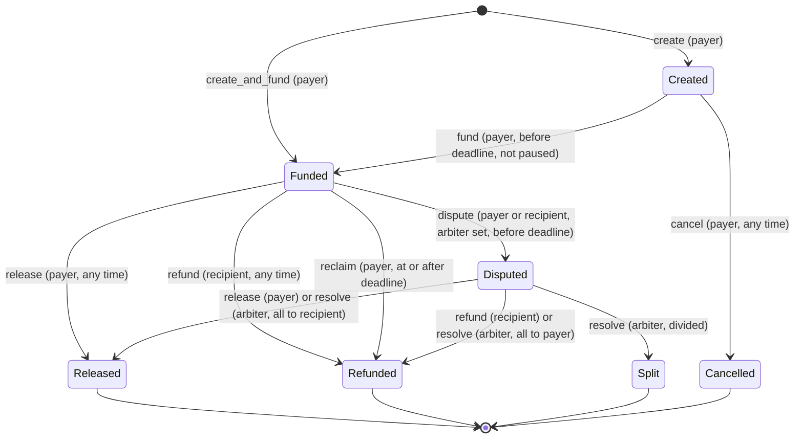

# Sisonke Escrow: implementation plan (v1, contract only)

Status: **binding plan** for the Coding agent. Adversary / Auditor / Reviewer agents check the
code against this document. Where this plan says MUST, deviating needs a written reason in the PR.

Toolchain: Rust 1.99.1, target `wasm32v1-none`, `soroban-sdk` 29.0.1, stellar CLI 28.1.0,
`@stellar/stellar-sdk` 17.2.1 (scripts), Node >= 22.18 (runs `.ts` directly).
Testnet USDC: issuer `GBBD47IF6LWK7P7MDEVSCWR7DPUWV3NY3DTQEVFL4NAT4AQH3ZLLFLA5`,
SAC `CBIELTK6YBZJU5UP2WWQEUCYKLPU6AUNZ2BQ4WWFEIE3USCIHMXQDAMA`.

---

## 0. Key decisions (and what changes versus Hodl)

| # | Decision | Why |
|---|---|---|
| D1 | **Token pinned at construction** (`__constructor(admin, token)`), immutable in v1. No allowlist. | Removes the fake-token class and an admin power. Multi-token is a future upgrade. `Escrow.token` is still stored per escrow for forward compatibility. |
| D2 | Optional **arbiter** per escrow, fixed at creation, may be `None`. Arbiter acts **only** on `Disputed` escrows and can only divide the escrow's own amount between payer and recipient (full release, full refund, or split). | Gives the brief's "release/refund conditions" a neutral path without making either party unilateral. |
| D3 | **Disputes only before the deadline** (`now < deadline`), by payer or recipient, only if an arbiter is set. Disputed escrows cannot be reclaimed. | Removes the race between "recipient disputes" and "payer reclaims" at/after the deadline. The rule fits in one sentence. |
| D4 | **Concessions stay open while Disputed**: payer may still `release`, recipient may still `refund`. | Each is against the actor's own interest, so it's always safe. It also means a dispute can end even if the arbiter never responds, as long as one party gives way. |
| D5 | Statuses describe **where the money went**: `Released` (all to recipient), `Refunded` (all to payer), `Split` (both), `Cancelled` (never funded). Who closed it is in `closed_by`, and the event name says which function. No `Expired` status: a payer reclaim is `Refunded` + `closed_by = payer` + `reclaimed` event. | The UI never confuses outcome with reason, and auditors get an unambiguous ledger. |
| D6 | `create`, `fund`, **and** `create_and_fund` (one signature). | The brief wants Created as a distinct state. The one-call path is what users will normally use. |
| D7 | **Pause blocks inflows only** (`create`, `create_and_fund`, `fund`). It never blocks `release`, `refund`, `reclaim`, `dispute`, `resolve`, `cancel` or the TTL bumps. | Incident response without letting the admin freeze user funds. |
| D8 | **Paged party index**: `PartyPage(addr, role, n)` holds at most 50 ids. Writes are O(1) and bounded. Payer, recipient and arbiter are all indexed. | Hodl's single `Vec` per user grows without bound and becomes a write-cost/size DoS. |
| D9 | **Accounting invariant on-chain**: instance `TotalLocked`. `fund` checks the contract's balance went up by exactly `amount`. | Gives a testable conservation law (I1) and a defence against any non-standard token behaviour. |
| D10 | **Upgrade = `update_current_contract(ContractExecutable::Wasm(hash))`**. `update_current_contract_wasm` is deprecated in SDK 29 and would fail `clippy -D warnings`. Never accept `ExternalRef`. | Same semantics as the brief's `update_current_contract_wasm`. `ExternalRef` would hand code control to another account. |
| D11 | **Storage-version guard**: `StorageVersion` in instance storage. Every escrow write fails `MigrationRequired` unless it equals the code's `STORAGE_VERSION`. `migrate()` is **permissionless** and idempotent. `lock_upgrades` requires the storage version to be current. | Closes the gap between the upgrade tx and the migrate tx. Lets anyone finish a migration even if the admin key is lost. A half-migrated contract can't be frozen forever. A rollback to older code after a migration is also refused. |
| D12 | **Error codes start at 100.** | When a SAC transfer fails inside our call, the SAC's own codes (1–13) come back to the caller. Ours must never collide with them (Tagit lesson). |
| D13 | **Every public write returns `Result<_, Error>`**, admin functions included. | Auth failures then look the same in tests: `Err(Err(InvokeError::Abort))`. |
| D14 | `created` event carries **every** escrow term. | An indexer can rebuild every escrow from events alone (I17). |
| D15 | Two-step admin, plus `cancel_admin_proposal`. Permanent `lock_upgrades`. | UUPS + Ownable2Step analogue. |

---

## 1. Folder structure (exact)

```
Sisonke-escrow/
├── Cargo.toml                      # workspace, members = ["contracts/*"]; profiles copied from Hodl + Tagit's dev opt-level
├── Cargo.lock                      # generated, committed
├── rust-toolchain.toml             # channel 1.99.1, targets ["wasm32v1-none"], components rustfmt+clippy
├── .gitignore                      # same as Hodl (target/, **/test_snapshots/, .stellar/, node_modules/, scripts/.env, .env*, !.env.example, .DS_Store)
├── Makefile
├── README.md                       # short: what it is, make targets, links to docs/
├── .github/workflows/ci.yml        # fmt --check, clippy -D warnings, cargo test; scripts: npm ci, tsc, bash -n
├── contracts/
│   ├── sisonke-escrow/
│   │   ├── Cargo.toml              # name "sisonke-escrow", crate-type ["cdylib","rlib"], doctest=false
│   │   ├── testdata/
│   │   │   └── upgrade_fixture.wasm   # committed build of contracts/upgrade-fixture
│   │   └── src/
│   │       ├── lib.rs              # #![no_std]; contract + #[contractimpl]; internal helpers impl block; constants
│   │       ├── errors.rs           # Error enum (§5)
│   │       ├── events.rs           # #[contractevent] structs + publish helpers (§6)
│   │       ├── storage.rs          # typed storage access, TTL policy, index paging (§2.4–2.5)
│   │       ├── types.rs            # Status, PartyRole, Escrow, EscrowView, ContractInfo, DataKey
│   │       └── test/
│   │           ├── mod.rs          # Setup fixture, helpers (as_signer, assert_auth_abort, events, balances)
│   │           ├── lifecycle.rs    # happy paths + time boundaries
│   │           ├── duplicates.rs   # duplicate execution + terminal finality
│   │           ├── auth.rs         # mock_auths-only negative/positive auth tests
│   │           ├── dispute.rs      # arbiter flows
│   │           ├── validation.rs   # create input checks, NotFound, batch limits
│   │           ├── accounting.rs   # TotalLocked, isolation, donations, atomicity, delta check
│   │           ├── index.rs        # paged party index + batch reads
│   │           ├── events.rs       # exact event shapes
│   │           ├── admin.rs        # pause, two-step admin
│   │           ├── upgrade.rs      # native-contract upgrade tests with the fixture wasm
│   │           ├── ttl.rs          # TTL policy
│   │           ├── model.rs        # randomized operation sequences vs reference model
│   │           └── wasm.rs         # #[ignore]d: compiled v1 wasm, upgrade + rollback, size/budget
│   └── upgrade-fixture/
│       ├── Cargo.toml              # name "sisonke-upgrade-fixture", crate-type ["cdylib"], publish=false
│       └── src/lib.rs              # test-only "v2" (§7.5). Never deployed to the real instance.
├── scripts/
│   ├── deploy.sh
│   ├── upgrade.sh
│   ├── e2e.ts
│   ├── package.json                # "sisonke-scripts", type module, @stellar/stellar-sdk 17.2.1, typescript, @types/node
│   ├── tsconfig.json               # same as Hodl
│   └── .env                        # GITIGNORED: E2E_*_SECRET testnet keys
├── deployments/
│   ├── testnet.env                 # generated by deploy.sh (public values only)
│   └── testnet-e2e.json            # generated by e2e.ts (machine-readable tx evidence for the web app)
└── docs/
    ├── PLAN.md                     # this file
    ├── CONTRACT.md                 # final reference (functions, rules matrix, errors, events, storage) – written by Coding agent from this plan
    ├── UPGRADES.md                 # how to ship v2, migration rules, trust model, testnet upgrade proof
    └── TRANSACTIONS.md             # generated by e2e.ts
```

`Cargo.toml` (workspace) = Hodl's file plus Tagit's:
```toml
[profile.dev.package."*"]
opt-level = 2     # keeps the model test fast
```

Fixture build: `stellar contract build --package sisonke-upgrade-fixture` then copy
`target/wasm32v1-none/release/sisonke_upgrade_fixture.wasm` →
`contracts/sisonke-escrow/testdata/upgrade_fixture.wasm` (Makefile `fixture`).

---

## 2. Data types and storage

### 2.1 Constants (`lib.rs` / `storage.rs`)

| Name | Value | Meaning |
|---|---|---|
| `VERSION` | `1` | Code version, returned by `version()`. Bump every release. |
| `STORAGE_VERSION` | `1` | Storage layout this code expects. Bump only when the layout changes. |
| `MAX_TITLE_LEN` | `64` | bytes (UTF-8), inclusive |
| `MAX_DURATION` | `365 * 86_400` | `deadline <= now + MAX_DURATION`, inclusive |
| `PAGE_SIZE` | `50` | ids per index page |
| `MAX_BATCH` | `20` | max ids per `get_escrows` |
| `DAY_IN_LEDGERS` | `17_280` | |
| `TTL_EXTEND_TO` | `120 * DAY_IN_LEDGERS` | for instance and persistent; below Testnet `max_entry_ttl` (3,110,400 ≈ 180 d) |
| `TTL_THRESHOLD` | `60 * DAY_IN_LEDGERS` | extend only if remaining TTL is below this |

### 2.2 `types.rs`

```rust
#[contracttype] #[derive(Clone, Copy, Debug, Eq, PartialEq)]
pub enum Status { Created, Funded, Disputed, Released, Refunded, Split, Cancelled }

#[contracttype] #[derive(Clone, Copy, Debug, Eq, PartialEq)]
pub enum PartyRole { Payer, Recipient, Arbiter }

#[contracttype] #[derive(Clone, Debug, Eq, PartialEq)]
pub struct Escrow {
    pub id: u64,                        // >= 1, never reused
    pub payer: Address,                 // immutable
    pub recipient: Address,             // immutable
    pub arbiter: Option<Address>,       // immutable; None => no dispute path
    pub token: Address,                 // == pinned token in v1; immutable
    pub amount: i128,                   // > 0, smallest unit (USDC 7 decimals); immutable
    pub deadline: u64,                  // ledger timestamp (s); immutable
    pub title: String,                  // <= 64 bytes, may be empty; immutable
    pub terms_hash: Option<BytesN<32>>, // sha256 of off-chain agreement; immutable
    pub status: Status,
    pub created_at: u64,
    pub created_ledger: u32,            // web app: getEvents startLedger
    pub funded_at: u64,                 // 0 until funded
    pub disputed_at: u64,               // 0 unless disputed
    pub disputed_by: Option<Address>,   // payer or recipient
    pub closed_at: u64,                 // 0 until terminal
    pub closed_by: Option<Address>,     // signer of the closing call
    pub paid_to_recipient: i128,        // 0 until terminal
    pub paid_to_payer: i128,            // 0 until terminal
    pub updated_ledger: u32,            // ledger of last transition (event lookup hint)
}

#[contracttype] pub struct EscrowView { pub escrow: Escrow, pub deadline_passed: bool } // now >= deadline

#[contracttype] pub struct ContractInfo {
    pub version: u32, pub storage_version: u32, pub admin: Address,
    pub pending_admin: Option<Address>, pub token: Address, pub paused: bool,
    pub upgrades_locked: bool, pub escrow_count: u64, pub total_locked: i128,
}
```

Only these fields change after `create`: `status`, `funded_at`, `disputed_at`,
`disputed_by`, `closed_at`, `closed_by`, `paid_to_recipient`, `paid_to_payer`,
`updated_ledger` (I9).

### 2.3 `DataKey` (variant **names** are the storage ABI: never rename or remove)

| Variant | Tier | Value | Written by |
|---|---|---|---|
| `Admin` | instance | `Address` | constructor, `accept_admin` |
| `PendingAdmin` | instance | `Address` | `propose_admin` / cleared by `accept_admin`, `cancel_admin_proposal` |
| `Token` | instance | `Address` | constructor only |
| `NextId` | instance | `u64` (starts 1) | `create*` |
| `TotalLocked` | instance | `i128` | `fund*`, every payout |
| `Paused` | instance | `bool` | `set_paused` |
| `UpgradesLocked` | instance | `bool` (never cleared) | `lock_upgrades` |
| `StorageVersion` | instance | `u32` | constructor, future `migrate` |
| `Escrow(u64)` | persistent | `Escrow` | every escrow transition |
| `PartyCount(Address, PartyRole)` | persistent | `u32` | `create*` |
| `PartyPage(Address, PartyRole, u32)` | persistent | `Vec<u64>` (≤ `PAGE_SIZE`) | `create*` |

Instance storage only holds a fixed set of small values, so its size is bounded.

### 2.4 Index paging (`storage.rs`)
`index_push(addr, role, id)`: `n = PartyCount`, `p = n / PAGE_SIZE`, append `id` to `PartyPage(addr, role, p)`
(creating it if missing), `PartyCount = n + 1` (checked add → `Overflow`). Extend TTL of both entries touched.
Called for payer, recipient, and arbiter (if `Some`) inside `create*`. Ids within a page are in creation order.

### 2.5 TTL policy
- `extend_instance()` (instance **and** code: `instance().extend_ttl(TTL_THRESHOLD, TTL_EXTEND_TO)`) is the **first line of every public write**, including admin writes and the bump functions.
- Every persistent `set` is followed by `extend_ttl(key, TTL_THRESHOLD, TTL_EXTEND_TO)`.
- Reads never write or extend anything, so simulation has no side effects.
- Permissionless keepers: `extend_escrow_ttl(id)` and `extend_index_ttl(addr, role, page)`. No auth, no state change, no event.
- Archival never loses funds. Persistent entries (including the SAC balance entry) are restorable, and since Protocol 23 an invoke tx restores archived footprint entries automatically. This is documented as a liveness/cost concern only. Escrows can last up to 365 days, which is longer than one 120-day extension, so the web app/keeper SHOULD call `extend_escrow_ttl` for open escrows older than 60 days.

---

## 3. Public functions

Contract: `#[contract] pub struct SisonkeEscrow;` with `#![allow(clippy::too_many_arguments)]`.

### 3.0 Execution order (MUST, every write)
1. `extend_instance()`
2. `ensure_storage_current()` → `MigrationRequired` (escrow writes only, plus `lock_upgrades`)
3. load escrow → `NotFound`
4. `require_auth()` on the required signer, which is always derived from **stored** escrow/admin data. The one exception is `dispute`'s `by` arg, which is then checked against the stored parties.
5. pause check (inflows only) → `Paused`
6. status check → `InvalidStatus`
7. time check → `DeadlinePassed` / `DeadlineNotReached`
8. argument checks
9. **effects**: write status/fields/`TotalLocked`, save, extend TTL
10. **interactions**: token transfer(s), always `from = current_contract` to `escrow.payer`/`escrow.recipient`, or `payer → contract` for funding
11. event(s)

Nothing is written before step 9, so a contract error can never leave a partial write. A failed
transfer traps and reverts the whole tx anyway. No function takes a destination address.

### 3.1 Constructor
`__constructor(env, admin: Address, token: Address)`. Runs atomically with deploy, so it can't be front-run.
Calls `token::Client::new(&env, &token).decimals()`, which panics if `token` isn't a token contract.
Sets `Admin`, `Token`, `NextId=1`, `TotalLocked=0`, `Paused=false`, `UpgradesLocked=false`,
`StorageVersion=STORAGE_VERSION`. Extends instance. Emits `init {admin, token, version}`.

### 3.2 Escrow writes

| Function | Signer | Preconditions (in check order) | Effects | Transfer | Events | Errors |
|---|---|---|---|---|---|---|
| `create(payer: Address, recipient: Address, arbiter: Option<Address>, amount: i128, deadline: u64, title: String, terms_hash: Option<BytesN<32>>) -> Result<u64, Error>` | payer | storage current; not paused; `amount > 0`; `payer != recipient`; none of payer/recipient/arbiter == current contract; arbiter ∉ {payer, recipient}; `deadline > now`; `deadline <= now + MAX_DURATION`; `title.len() <= 64` | new id (`NextId`++ checked); status `Created`; save; index payer, recipient, arbiter | none | `created` | 141, 140, 120, 121, 123, 122, 124, 125, 126, 143 |
| `fund(id: u64) -> Result<(), Error>` | escrow.payer | storage current; exists; not paused; status `Created`; `now < deadline` | status `Funded`, `funded_at`; `TotalLocked += amount` (checked); save | payer → contract `amount`; then assert contract balance delta == `amount` | `funded` | 141, 100, 140, 101, 102, 143, 107 |
| `create_and_fund(same args as create) -> Result<u64, Error>` | payer (one auth tree covering the inner `transfer`) | union of `create` + `fund` (the fund checks are implied) | as create then fund | as fund | `created`, `funded` | as create + 107 |
| `release(id) -> Result<(), Error>` | escrow.payer | storage current; exists; status ∈ {`Funded`, `Disputed`} (no time condition) | `Released`; `paid_to_recipient = amount`; `closed_*`; `TotalLocked -= amount` | contract → recipient `amount` | `released` | 141, 100, 101 |
| `refund(id) -> Result<(), Error>` | escrow.recipient | storage current; exists; status ∈ {`Funded`, `Disputed`} (no time condition) | `Refunded`; `paid_to_payer = amount`; `closed_*`; `TotalLocked -= amount` | contract → payer `amount` | `refunded` | 141, 100, 101 |
| `reclaim(id) -> Result<(), Error>` | escrow.payer | storage current; exists; status == `Funded` (**not** Disputed); `now >= deadline` | `Refunded`; `paid_to_payer = amount`; `closed_*`; `TotalLocked -= amount` | contract → payer `amount` | `reclaimed` | 141, 100, 101, 103 |
| `dispute(id, by: Address) -> Result<(), Error>` | `by` | storage current; exists; `by.require_auth()`; `by ∈ {payer, recipient}`; status == `Funded`; arbiter is `Some`; `now < deadline` | `Disputed`; `disputed_at`, `disputed_by = by` | none | `disputed` | 141, 100, 105, 101, 104, 102 |
| `resolve(id, recipient_amount: i128) -> Result<(), Error>` | escrow.arbiter | storage current; exists; arbiter `Some` (else 104, checked before auth because there is no one to authorize); `arbiter.require_auth()`; status == `Disputed`; `0 <= recipient_amount <= amount` | `payer_amount = amount - recipient_amount`; status = `Released` if `payer_amount == 0`, `Refunded` if `recipient_amount == 0`, else `Split`; paid fields; `closed_*`; `TotalLocked -= amount` | contract → recipient `recipient_amount` (skip if 0); contract → payer `payer_amount` (skip if 0) | `resolved` | 141, 100, 104, 101, 106 |
| `cancel(id) -> Result<(), Error>` | escrow.payer | storage current; exists; status == `Created` (any time) | `Cancelled`; `closed_*` | none | `cancelled` | 141, 100, 101 |
| `extend_escrow_ttl(id) -> Result<(), Error>` | nobody | exists | TTL only | none | none | 100 |
| `extend_index_ttl(party: Address, role: PartyRole, page: u32) -> Result<(), Error>` | nobody | none (missing entries are skipped) | TTL only (count + that page) | none | none | — |

`closed_*` = `closed_at = now`, `closed_by = Some(signer)`, `updated_ledger = sequence`. Every transition also
sets `updated_ledger`.

### 3.3 Admin writes (all `Result<(), Error>`; signer is the stored `Admin` unless noted)

| Function | Preconditions | Effects | Events | Errors |
|---|---|---|---|---|
| `set_paused(paused: bool)` | — (idempotent) | `Paused = paused` | `paused {paused}` | — |
| `propose_admin(new_admin: Address)` | — | `PendingAdmin = new_admin` (replaces) | `admin_proposed` | — |
| `cancel_admin_proposal()` | pending exists | remove `PendingAdmin` | `admin_proposal_cancelled` | 201 |
| `accept_admin()` (signer: **pending admin**) | pending exists | `Admin = pending`; remove pending | `admin_changed` | 201 |
| `upgrade(new_wasm_hash: BytesN<32>)` | not locked | emit, then `env.deployer().update_current_contract(ContractExecutable::Wasm(new_wasm_hash))`; new code runs from the next invocation | `upgraded {new_wasm_hash, from_version: VERSION}` | 200 (host traps if hash not uploaded) |
| `lock_upgrades()` | not locked; storage current | `UpgradesLocked = true` forever | `upgrades_locked` | 200, 141 |
| `migrate()` (signer: **nobody**, permissionless) | v1: always `Err(NothingToMigrate)` when `StorageVersion == STORAGE_VERSION`; pattern in §7.3 | — | `migrated {from, to}` (vN only) | 142 |

The admin has **no other powers**. It can't sign for, move, redirect, freeze, re-time or re-status any
escrow, and it can't change the token.

### 3.4 Reads (no auth, no writes, no TTL extension)

| Function | Returns |
|---|---|
| `get_escrow(id) -> Result<EscrowView, Error>` | 100 if unknown |
| `get_escrows(ids: Vec<u64>) -> Result<Vec<EscrowView>, Error>` | in given order, unknown ids skipped; `len > MAX_BATCH` → 127 |
| `escrow_count() -> u64` | `NextId - 1`; ids are `1..=count` |
| `party_escrow_count(party: Address, role: PartyRole) -> u32` | |
| `party_escrow_ids(party: Address, role: PartyRole, page: u32) -> Vec<u64>` | ≤ 50 ids, oldest first; empty past the end |
| `total_locked() -> i128` | |
| `token() -> Address` | pinned token |
| `admin() -> Address`, `pending_admin() -> Option<Address>` | |
| `is_paused() -> bool`, `upgrades_enabled() -> bool` | |
| `version() -> u32` | `VERSION` (code constant) |
| `storage_version() -> u32` | stored `StorageVersion` |
| `info() -> ContractInfo` | everything above in one call (web app header) |

Web app mapping: get by id → `get_escrow`. List by party → `party_escrow_count` + `party_escrow_ids`
pages, then `get_escrows` in batches of 20. Contract address → `deployments/testnet.env`. Tx hashes →
RPC `getEvents` with topic filter `["sisonke", "*", <id u64>]` from `created_ledger` (RPC retention ≈ 7
days; older history uses stored `*_at` fields; an indexer comes later).

---

## 4. Rules: authorization / state-transition matrix

**Plain-language rules (copy into CONTRACT.md verbatim):**
1. Only the **payer** can fund, cancel (before funding), release, and reclaim after the deadline.
2. Only the **recipient** can refund (voluntarily send the money back), at any time while funds are locked.
3. If an **arbiter** was named at creation, the payer or the recipient may open a dispute while the escrow is
   Funded **and before the deadline**. Once disputed: the payer can't reclaim, the arbiter may divide the
   amount between payer and recipient in any proportion, and the payer may still release / the recipient may still
   refund (concede). The arbiter can do nothing unless a dispute is open.
4. With **no arbiter**, there is no dispute path: the funds move only by payer release, recipient refund, or payer
   reclaim at/after the deadline.
5. Neither party can take the funds for themselves alone. The payer can only get funds back unilaterally after the
   deadline, and only if no dispute was opened before it. The recipient can never pay themselves; only the payer
   or the arbiter can release.
6. The **admin** can't perform any escrow action. Admin can pause new escrows/funding and upgrade the code (see §7).
7. **Deadline second:** at `now == deadline` the deadline has passed (fund and dispute refused, reclaim allowed).
8. Funds only ever go to the escrow's own payer and/or recipient, and each escrow pays out exactly once.

**Matrix.** ✔ = allowed (→ result status). The error shown is what any other caller/time gets. A wrong signer
always fails at `require_auth` (host auth error) before any contract error.

| Function \ Status | Created | Funded, `now < deadline` | Funded, `now >= deadline` | Disputed | Released / Refunded / Split / Cancelled |
|---|---|---|---|---|---|
| `fund` | payer ✔ → Funded if `now < deadline`, else 102 | 101 | 101 | 101 | 101 |
| `cancel` | payer ✔ → Cancelled (any time) | 101 | 101 | 101 | 101 |
| `release` | 101 | payer ✔ → Released | payer ✔ → Released | payer ✔ → Released (concession) | 101 |
| `refund` | 101 | recipient ✔ → Refunded | recipient ✔ → Refunded | recipient ✔ → Refunded (concession) | 101 |
| `reclaim` | 101 | 103 | payer ✔ → Refunded | 101 | 101 |
| `dispute` | 101 | payer or recipient ✔ → Disputed (104 if no arbiter) | 102 (104 if no arbiter) | 101 | 101 |
| `resolve` | 101 (104 if no arbiter) | 101 | 101 | arbiter ✔ → Released / Refunded / Split | 101 (104 if no arbiter) |
| pause applies? | yes (`fund`) | no | no | no | — |

`create`/`create_and_fund`: payer, not paused. The arbiter, admin and strangers are never valid signers for
`fund/cancel/release/refund/reclaim/dispute`. Only the arbiter can sign `resolve`.



Replay of a signed call: protected by the Soroban auth nonce (address credentials) or the tx sequence number (source-account
credentials). Logical duplicates (a second release, and so on) are refused by the status check (101).

---

## 5. Errors (`errors.rs`): stable codes, never renumber

`#[contracterror] #[derive(Copy, Clone, Debug, Eq, PartialEq, PartialOrd, Ord)] #[repr(u32)] pub enum Error`

| Code | Name | When |
|---|---|---|
| 100 | `NotFound` | no escrow with this id |
| 101 | `InvalidStatus` | action not allowed in current status (includes **every duplicate**) |
| 102 | `DeadlinePassed` | `fund` / `dispute` at or after deadline |
| 103 | `DeadlineNotReached` | `reclaim` before deadline |
| 104 | `NoArbiter` | `dispute` / `resolve` on an escrow without arbiter |
| 105 | `NotParty` | `dispute` `by` is neither payer nor recipient |
| 106 | `InvalidSplit` | `recipient_amount < 0` or `> amount` |
| 107 | `TransferMismatch` | contract balance delta after funding != `amount` |
| 120 | `InvalidAmount` | `amount <= 0` |
| 121 | `SameParty` | `payer == recipient` |
| 122 | `InvalidArbiter` | arbiter == payer or recipient |
| 123 | `InvalidParty` | payer, recipient or arbiter == this contract |
| 124 | `DeadlineInPast` | `deadline <= now` at create |
| 125 | `DeadlineTooFar` | `deadline > now + MAX_DURATION` |
| 126 | `TitleTooLong` | `title` > 64 bytes |
| 127 | `BatchTooLarge` | `get_escrows` with > 20 ids |
| 140 | `Paused` | inflow while paused |
| 141 | `MigrationRequired` | `StorageVersion != STORAGE_VERSION` |
| 142 | `NothingToMigrate` | `migrate` when already current |
| 143 | `Overflow` | checked arithmetic failed (`NextId`, `TotalLocked`, `PartyCount`) |
| 200 | `UpgradesLocked` | `upgrade` / `lock_upgrades` after lock |
| 201 | `NoPendingAdmin` | `accept_admin` / `cancel_admin_proposal` with none pending |

Auth failures aren't in this enum. The host aborts with `Error(Auth, InvalidAction)`. SAC failures (for
example insufficient balance, missing trustline) surface as SAC codes 1–13 and revert everything.

---

## 6. Events (`events.rs`)

All via `#[contractevent]`, data format = map (default) unless noted. Prefix symbol `"sisonke"`.
Escrow events: topics `("sisonke", <action>, id: u64)`. One escrow's history = one `getEvents` filter.
Event name == function name. **Each successful write emits exactly the events listed; failed calls emit none.**

| Topics | Data |
|---|---|
| `("sisonke","init")` | `{admin, token, version}` |
| `("sisonke","created", id)` | `{payer, recipient, arbiter: Option<Address>, token, amount, deadline, title, terms_hash: Option<BytesN<32>>}` |
| `("sisonke","funded", id)` | `{payer, amount}` |
| `("sisonke","released", id)` | `{by, recipient, amount}` (`by` = payer) |
| `("sisonke","refunded", id)` | `{by, payer, amount}` (`by` = recipient) |
| `("sisonke","reclaimed", id)` | `{payer, amount}` |
| `("sisonke","disputed", id)` | `{by}` |
| `("sisonke","resolved", id)` | `{arbiter, recipient_amount, payer_amount, status}` |
| `("sisonke","cancelled", id)` | `{payer}` |
| `("sisonke","paused")` | `{paused}` |
| `("sisonke","admin_proposed", new_admin)` | vec `[]` |
| `("sisonke","admin_proposal_cancelled")` | vec `[]` |
| `("sisonke","admin_changed", new_admin)` | `{previous_admin}` |
| `("sisonke","upgraded")` | `{new_wasm_hash, from_version}` |
| `("sisonke","upgrades_locked")` | vec `[]` |
| `("sisonke","migrated")` | `{from, to}` (defined now, first emitted by v2) |

`create_and_fund` emits `created` then `funded`. The SAC emits its own `transfer` events too.

---

## 7. Upgradeability (UUPS analogue), admin model, trust

### 7.1 Mapping
| UUPS / OZ | Sisonke |
|---|---|
| `upgradeTo(impl)` in the implementation | `upgrade(new_wasm_hash)` in the contract itself, `update_current_contract(ContractExecutable::Wasm(..))` |
| `_authorizeUpgrade onlyOwner` | `Admin.require_auth()` |
| proxy keeps storage + balance | same contract address, storage and SAC balances untouched |
| `upgradeToAndCall` | `upgrade` tx, then `migrate()` tx (Soroban has no self re-entry). Writes are guarded until migrated. |
| final implementation without upgrade | `lock_upgrades()`, permanent; every future version MUST keep honouring `UpgradesLocked` |
| `Ownable2Step` | `propose_admin` → `accept_admin`, `cancel_admin_proposal` |

### 7.2 Admin
Single `Admin` address (it may be a multisig account or a contract). Its powers are `set_paused`, the admin
handover, `upgrade` and `lock_upgrades`. That's the whole list.

### 7.3 Version / migrate pattern (for v2+, documented in UPGRADES.md)
- `VERSION` bumps every release. `STORAGE_VERSION` bumps only on a layout change.
- vN `migrate()`: permissionless. `if stored == STORAGE_VERSION → Err(NothingToMigrate)`. `if stored != STORAGE_VERSION - 1 → Err(MigrationRequired)` (no skipping). Transform (bounded work; a large transform uses a cursor key and multiple calls, with `StorageVersion` set only at the end). Set `StorageVersion = STORAGE_VERSION`. Emit `migrated{from,to}`.
- Until migrated, every escrow write and `lock_upgrades` returns `MigrationRequired`. Reads still work.
- If old code is rolled back to after a migration, it sees `stored > its STORAGE_VERSION` and refuses writes. That's intended.
- Layout rules: never rename/remove `DataKey` variants, `Status` variants or `Escrow` fields. New `Escrow` fields MUST be `Option<T>` (SDK ≥ 28 reads an absent field as `None`). Removed fields are dropped on rewrite, so remove only via a migration. Every version keeps `upgrade`, `lock_upgrades`, the admin functions, `version`, `storage_version` and `migrate`.
- `upgrade.sh` runs `migrate` right after upgrading when `MIGRATE=1`.

### 7.4 Trust assumptions (MUST appear in CONTRACT.md "Security model")
1. **Upgrade power is total.** While `upgrades_enabled() == true`, the admin can install code that moves every
   locked token. Users trust the admin key the way they'd trust a UUPS owner. Mitigations: two-step handover;
   `upgraded` event with the wasm hash (anyone can `stellar contract fetch` it and diff it against a reproducible build); `lock_upgrades`
   is permanent and survives admin changes; recommended a multisig admin and a lock before mainnet. A timelock is deferred to v2.
2. **Without upgrades, the admin can't touch funds.** `set_paused` only blocks inflows.
3. **The arbiter** is chosen by the payer, visible on-chain (`get_escrow`, `created` event) before the recipient does
   any work, and immutable. A recipient who doesn't accept the arbiter shouldn't start work, and may `refund` to exit.
   The arbiter is trusted for fairness and liveness **only after** a dispute opens. If it never acts, funds stay locked until
   one party concedes. There is no dispute timeout in v1, by design: there is no neutral default.
4. **USDC issuer (Circle)** can freeze or claw back under the asset's flags, which is outside contract control. If a recipient is
   frozen or has no trustline, `release` reverts atomically (state unchanged). `refund`, or `resolve` to the payer, remain possible.
5. **RPC event retention** is about 7 days. Longer history needs an indexer, or the stored `*_at` fields.

### 7.5 `contracts/upgrade-fixture` (test-only v2)
Independent `no_std` crate. It re-declares, **by copy**, `DataKey` (the variants it uses), `Status`, `PartyRole`, `Escrow`.
Matching by name and shape is itself the layout-compatibility test. Exposes:
- `version() -> u32 { 2 }`, `storage_version()`, `escrow_count()`, `total_locked()`, `admin()`, `get_escrow(id) -> Escrow` (raw)
- `migrate() -> Result<(), FixtureError>`: permissionless. Requires stored `StorageVersion == 1`, sets 2, writes `DataKey::FixtureMarker` (new key), emits `("sisonke","migrated") {from:1,to:2}`. A second call errors.
- `upgrade(new_wasm_hash)`: admin-gated, honours `UpgradesLocked`. Enables rollback tests.
Header comment: rebuild instructions + "never deploy to the production instance".

---

## 8. Security invariants (numbered, each tied to tests)

- **I1 Conservation:** `total_locked == Σ amount over escrows in {Funded, Disputed}` and `token.balance(contract) >= total_locked` (equality when nobody donated).
- **I2 Exact payout:** for `Released | Refunded | Split`: `paid_to_recipient + paid_to_payer == amount`, both `>= 0`; `Released ⇒ paid_to_payer == 0`; `Refunded ⇒ paid_to_recipient == 0`; `Split ⇒ both > 0`; `Cancelled ⇒ both == 0` and nothing was ever transferred.
- **I3 Destinations:** tokens leave the contract only to `escrow.payer` or `escrow.recipient` of the escrow being closed. The arbiter, admin and third parties never receive anything. No public function takes a destination address.
- **I4 Finality:** in `Released | Refunded | Split | Cancelled`, every escrow write returns 101 and changes no storage, balance or event.
- **I5 Single execution:** per escrow, at most one `funded` event and at most one closing event (`released | refunded | reclaimed | resolved | cancelled`), and total outflow ≤ `amount`.
- **I6 Transition closure:** the only status changes are the edges in §4. Status never moves backwards.
- **I7 Authorization:** each transition succeeds only with the signer given in §4. With only admin/stranger/arbiter (where not listed) signatures, every escrow write fails at auth.
- **I8 Admin can't move funds:** running every admin function with full auth leaves all balances and escrow records unchanged.
- **I9 Immutable terms:** `id, payer, recipient, arbiter, token, amount, deadline, title, terms_hash, created_at, created_ledger` never change.
- **I10 Deadline partition:** for every `now`, exactly one of {fund/dispute permitted by time, reclaim permitted by time} holds.
- **I11 Dispute gating:** `Disputed` is reachable only with `arbiter.is_some()` and `now < deadline`. `reclaim` never succeeds from `Disputed`. `resolve` succeeds only from `Disputed`, signed by that escrow's arbiter.
- **I12 IDs:** ids are unique, sequential from 1, never reused; `escrow_count == NextId - 1`.
- **I13 Index:** each escrow id appears exactly once in its payer's, recipient's and (if any) arbiter's index, in creation order. No page holds more than `PAGE_SIZE` entries. `party_escrow_count` equals the total across pages.
- **I14 Atomicity:** a failed call (contract error, auth failure or SAC failure) leaves storage, balances and events unchanged.
- **I15 Pause scope:** pause blocks only `create`, `create_and_fund`, `fund`.
- **I16 Upgrade preservation:** after `upgrade`, the address, all storage and all balances are identical. `lock_upgrades` blocks every later `upgrade`, including after an admin handover.
- **I17 Event completeness:** replaying `sisonke` events reproduces every escrow's current status and paid amounts.
- **I18 Storage guard:** if `StorageVersion != STORAGE_VERSION`, every escrow write and `lock_upgrades` fails with 141.
- **I19 TTL:** after any write touching an entry, that entry's TTL is ≥ `TTL_THRESHOLD`, and the instance TTL is ≥ `TTL_THRESHOLD` after any write.

---

## 9. Test plan (all MUST exist; names are binding)

**Conventions.** `test/mod.rs::Setup` registers a real SAC (`register_stellar_asset_contract_v2`) as USDC, mints to the payer,
registers `SisonkeEscrow` with `(admin, usdc)`, timestamp `START = 1_750_000_000`, sequence 1000,
`set_max_entry_ttl(3_110_400)`. Helpers: `as_signer(who, fn, args, call)` (installs **`mock_auths`** for exactly one
`MockAuth`, with sub_invokes when a transfer is involved), `assert_auth_abort(result)` (`Err(Err(InvokeError::Abort))`),
`events()` (filtered by contract), `snapshot()` (balances + escrow + total_locked, used to prove "nothing changed").
**`mock_all_auths` may be used only to set up state in positive-path tests. Every auth test, negative or positive, uses `mock_auths`.**
Positive single-signer tests also assert `env.auths()` equals exactly the expected tree.

**lifecycle.rs**
`create_then_fund_then_release_pays_recipient` · `create_and_fund_then_release` · `recipient_refund_returns_funds_to_payer` ·
`payer_reclaims_at_deadline` · `payer_cancels_unfunded_escrow` · `cancel_after_deadline_is_allowed` ·
`release_and_refund_allowed_after_deadline` · `funded_escrow_stays_funded_past_deadline_until_acted_on` ·
`fund_at_or_after_deadline_fails` · `reclaim_before_deadline_fails` · `deadline_second_is_partitioned` (I10: at `deadline-1` fund/dispute ok and reclaim 103; at `deadline` fund/dispute 102 and reclaim ok) · `escrow_records_timestamps_ledgers_and_closer`

**duplicates.rs**
`double_fund_fails` · `double_release_fails` · `double_refund_fails` · `release_after_refund_fails` · `refund_after_release_fails` ·
`double_reclaim_fails` · `double_resolve_fails` · `double_cancel_fails` · `dispute_twice_fails` ·
`terminal_statuses_reject_every_action` (table: 4 terminal statuses × {fund, cancel, release, refund, reclaim, dispute, resolve} → 101, snapshot unchanged) ·
`rejected_duplicate_changes_nothing` (balances, escrow, total_locked, no new events)

**auth.rs** (only `mock_auths`)
`create_requires_payer_signature` (stranger signs a create naming the victim payer → abort) · `create_and_fund_requires_payer_signature` ·
`create_and_fund_is_one_payer_auth_tree` (asserts `env.auths()` = payer: create_and_fund → sub-invoke usdc.transfer) ·
`fund_rejects_everyone_but_payer` · `release_rejects_recipient_arbiter_admin_stranger` · `refund_rejects_payer_arbiter_admin_stranger` ·
`reclaim_rejects_everyone_but_payer` · `cancel_rejects_everyone_but_payer` · `dispute_requires_signature_of_by` (by=recipient, signed by stranger → abort) ·
`dispute_by_non_party_fails_not_party` (arbiter/stranger/admin sign as themselves → 105) · `resolve_rejects_everyone_but_arbiter` ·
`admin_functions_reject_non_admin` (set_paused, propose_admin, cancel_admin_proposal, upgrade, lock_upgrades × payer/recipient/stranger) ·
`accept_admin_rejects_everyone_but_pending` · `admin_cannot_perform_any_escrow_action` · `release_auth_tree_is_exactly_payer_release_id` ·
`ttl_bumps_need_no_auth` (empty auths)

**dispute.rs**
`recipient_dispute_blocks_reclaim_after_deadline` · `payer_can_dispute` · `dispute_without_arbiter_fails` · `dispute_at_or_after_deadline_fails` ·
`dispute_on_created_fails` · `arbiter_full_release_is_released` · `arbiter_full_refund_is_refunded` · `arbiter_split_pays_both_exactly` ·
`resolve_out_of_range_fails` (−1, amount+1) · `resolve_zero_side_skips_transfer` · `resolve_on_undisputed_escrow_fails` ·
`arbiter_cannot_act_before_dispute` · `payer_concedes_release_during_dispute` · `recipient_concedes_refund_during_dispute` ·
`resolve_after_concession_fails`

**validation.rs**
`create_validates_inputs_in_documented_order` (each of 120,121,122,123,124,125,126 and the precedence among them) ·
`title_cap_is_inclusive_and_in_bytes` (64 ok, 65 fail, multibyte) · `max_duration_is_inclusive` · `zero_and_negative_amounts_fail` ·
`unknown_id_is_not_found_for_every_function` · `get_escrows_rejects_oversized_batch` · `constructor_rejects_non_token`

**accounting.rs**
`total_locked_tracks_funded_and_disputed` · `escrows_are_isolated` (3 escrows; closing one moves only its amount) ·
`donation_does_not_break_settlement` (direct transfer to contract; I1 as ≥; all escrows settle exactly) ·
`underfunded_fund_leaves_no_trace` · `underfunded_create_and_fund_leaves_no_trace` ·
`fee_on_transfer_token_is_rejected` (test-only token contract that skims 1 unit, registered as pinned token → 107, nothing changes) ·
`funds_only_reach_payer_or_recipient` (arbiter/admin/stranger balances stay 0 through every flow)

**index.rs**
`index_records_payer_recipient_and_arbiter` · `no_arbiter_means_no_arbiter_entry` · `index_page_rolls_over_at_page_size` (51 escrows → page0=50, page1=1, count=51) ·
`page_past_end_is_empty` · `get_escrows_preserves_order_and_skips_unknown` · `spam_escrows_do_not_touch_other_parties_index`

**events.rs**
`every_transition_emits_exact_event` (one assertion per event in §6, exact topics+data) · `create_and_fund_emits_created_then_funded` ·
`escrow_event_topics_are_prefix_action_id` · `created_event_carries_all_terms` · `failed_calls_emit_no_events` · `constructor_emits_init`

**admin.rs**
`pause_blocks_create_create_and_fund_and_fund` · `pause_never_blocks_exits` (release, refund, reclaim, dispute, resolve, cancel, ttl bumps) ·
`unpause_restores_inflows` · `admin_handover_is_two_step` · `cancel_admin_proposal_clears_pending` · `old_admin_loses_every_power` ·
`admin_functions_do_not_move_funds` (I8: every admin fn with auth; snapshot unchanged except admin keys)

**upgrade.rs** (fixture via `contractimport!(file = "testdata/upgrade_fixture.wasm")`)
`version_and_storage_version_start_at_one` · `admin_upgrade_preserves_address_storage_and_funds` (Created + Funded + Disputed escrows; fixture `get_escrow` decodes all; balance & total_locked equal; admin equal) ·
`upgrade_emits_upgraded_event` · `only_admin_can_upgrade` · `upgrade_to_unknown_hash_fails` · `lock_upgrades_is_permanent_across_handover` ·
`lock_upgrades_twice_fails` · `v1_migrate_returns_nothing_to_migrate` · `writes_blocked_on_storage_version_mismatch` (set `StorageVersion=2` via `as_contract`; every escrow write → 141; reads still work; `lock_upgrades` → 141) ·
`fixture_migrate_runs_once`

**ttl.rs**
`create_extends_escrow_index_and_instance` (all = 120 d) · `transition_tops_up_low_ttl` · `healthy_entries_not_extended` (advance 10 d → TTL 110 d after write) ·
`extend_escrow_ttl_is_permissionless_and_extends` · `extend_index_ttl_is_permissionless` · `long_escrow_survives_with_bumps` (advance 300 d with bumps every 50 d; release ok) ·
`archived_escrow_still_settles` (SDK emulates P23 auto-restore; document behaviour)

**model.rs**
`model_random_sequences_hold_invariants`: xorshift RNG (Tagit pattern), `SEEDS=12` (`MODEL_SEEDS` env override), 250 steps over
{create, create_and_fund, fund, release, refund, reclaim, dispute, resolve(random split), cancel, time warp, pause toggle, donation}
with random signers among {payer, recipient, arbiter, admin, stranger}, using `mock_auths` per step. After every step check I1, I2, I3, I4,
I5, I6, I11, I12, I13 against a plain Rust reference model, and that the result (ok / error code / auth abort) matches the model's prediction.

**wasm.rs** (`#[ignore]`; `make test` builds first and runs `--include-ignored`)
`compiled_v1_full_lifecycle` · `compiled_v1_upgrade_to_fixture_and_rollback_before_migrate` (rollback to v1 wasm, then release works) ·
`rollback_after_migration_blocks_v1_writes` (141) · `wasm_size_under_64_kib` · `release_and_create_and_fund_within_budget` (instructions < 10M)

---

## 10. Scripts and Makefile

### 10.1 `scripts/deploy.sh` (bash, `set -euo pipefail`)
Env: `NETWORK=testnet`, `SOURCE=sisonke-deployer`, `ADMIN` (default = SOURCE address), `USDC_ISSUER` (Circle testnet),
`EXPECTED_USDC_SAC` (testnet constant above).
1. Check `stellar` CLI. Create/fund the identity via Friendbot (`stellar keys generate --fund` / `keys fund`).
2. `stellar contract id asset --asset USDC:$USDC_ISSUER`. On testnet, assert it equals `EXPECTED_USDC_SAC` (abort otherwise). Run `contract asset deploy` only if missing.
3. `stellar contract build --package sisonke-escrow`, then `stellar contract upload` → `WASM_HASH`.
4. `stellar contract deploy --wasm-hash $WASM_HASH --alias sisonke-escrow -- --admin $ADMIN --token $USDC_SAC`.
5. Sanity reads (`--send=no`): `token == USDC_SAC`, `version == 1`, `storage_version == 1`, `is_paused == false`, `admin == ADMIN`.
6. Write `deployments/$NETWORK.env`: `NEXT_PUBLIC_STELLAR_NETWORK`, `NEXT_PUBLIC_NETWORK_PASSPHRASE`, `NEXT_PUBLIC_RPC_URL`,
   `NEXT_PUBLIC_HORIZON_URL`, `NEXT_PUBLIC_EXPLORER_URL`, `NEXT_PUBLIC_SISONKE_CONTRACT_ID`, `NEXT_PUBLIC_USDC_SAC_ID`,
   `NEXT_PUBLIC_USDC_ISSUER`, `NEXT_PUBLIC_SISONKE_DEPLOY_LEDGER` (RPC `getLatestLedger`), `SISONKE_WASM_HASH`, `SISONKE_ADMIN`.
7. Print the explorer link. (TypeScript bindings come later with the web app; not in this phase.)

### 10.2 `scripts/upgrade.sh [CONTRACT_ID]`
Env: `WASM` (optional path; default is to build the current source), `MIGRATE=1`, `NETWORK`, `SOURCE`.
Checks: SOURCE is the `admin`, `upgrades_enabled == true`. Prints `version`/`storage_version` before.
Upload → `upgrade --new_wasm_hash` → print `version`/`storage_version` after. If `MIGRATE=1`, invoke `migrate`.
If the new storage version differs from the old and `MIGRATE` isn't set, print a loud warning ("writes are blocked until migrate").
Update `SISONKE_WASM_HASH` in `deployments/$NETWORK.env`. Rollback = `WASM=old.wasm scripts/upgrade.sh`.
**Testnet upgrade proof** (`make upgrade-demo`): deploy a *separate* instance (`ALIAS=sisonke-upgrade-demo`), `create_and_fund` 1 USDC,
`WASM=contracts/sisonke-escrow/testdata/upgrade_fixture.wasm MIGRATE=1 scripts/upgrade.sh <demo-id>`, read `version`(2), `get_escrow`,
`total_locked` and the SAC balance. Record the hashes in UPGRADES.md.

### 10.3 `scripts/e2e.ts` (Hodl structure; `node e2e.ts setup` then `node e2e.ts`)
Accounts in `scripts/.env`: payer, recipient, arbiter, stranger (all Friendbot-funded; USDC trustlines for payer and recipient only, because the arbiter never
receives funds). Payer needs ≥ 5 testnet USDC from faucet.circle.com. Amount: 1 USDC (10_000_000) per escrow.
Error names map keyed by code (100+). Rejections are shown by simulation **and then submitted on-chain** for a verifiable failed hash:
*unauthorized* = recording simulation with the auth entries stripped, signed by the attacker; *duplicate* = replay of the original call's
footprint + auth. A row passes only if the on-chain error equals the simulated one.

| Scenario | Steps (signer) | Required evidence |
|---|---|---|
| A. Two-step happy path | `create` (payer) → `fund` (payer) → `release` (payer) | creation, deposit, release |
| B. Recipient refund | `create_and_fund` (payer) → `refund` (recipient) | refund |
| C. Unauthorized | `create_and_fund` (payer, arbiter set); on-chain rejects: `release` by recipient, `release` by stranger, `refund` by payer, `resolve` by stranger, `reclaim` by recipient, `set_paused` by stranger; `get_escrow` still Funded; then `release` (payer) | rejected unauthorized attempts |
| D. Duplicates | `release` A again, `refund` B again, `fund` A again → 101 on-chain | rejected duplicate execution |
| E. Dispute + split | `create_and_fund` (arbiter, deadline now+90 s) → `dispute` (recipient) → `resolve` by stranger rejected → wait past deadline → `reclaim` (payer) rejected 101 → `resolve(6_000_000)` (arbiter) → Split | dispute rules |
| F. Deadline reclaim | `create_and_fund` (deadline now+60 s) → `reclaim` early rejected 103 → wait → `reclaim` (payer) → Refunded | refund condition by time |
| G. Cancel | `create` → `cancel` (payer) → `fund` rejected 101 | unfunded path |

Output: `docs/TRANSACTIONS.md` (Stellar Expert links per step, account table, legend of error codes, summary) and
`deployments/testnet-e2e.json` (`[{scenario, step, signer, method, escrow_id, expected, result, hash, ledger}]`). Exit 1 if any row fails.
Waits for the E and F deadlines overlap with other scenarios, as in Hodl.

### 10.4 `Makefile`
```make
.PHONY: build fixture test test-fast soak fmt lint check deploy upgrade upgrade-demo e2e-setup e2e clean
build:        ; stellar contract build --package sisonke-escrow
fixture:      ; stellar contract build --package sisonke-upgrade-fixture && cp target/wasm32v1-none/release/sisonke_upgrade_fixture.wasm contracts/sisonke-escrow/testdata/upgrade_fixture.wasm
test: build   ; cargo test -- --include-ignored
test-fast:    ; cargo test
soak:         ; MODEL_SEEDS=300 cargo test model
fmt:          ; cargo fmt --all
lint:         ; cargo fmt --all -- --check && cargo clippy --all-targets -- -D warnings
check: lint test
deploy:       ; ./scripts/deploy.sh
upgrade:      ; ./scripts/upgrade.sh
upgrade-demo: ; ALIAS=sisonke-upgrade-demo ./scripts/deploy.sh && ...   # per §10.2
e2e-setup:    ; cd scripts && npm install && node e2e.ts setup
e2e:          ; cd scripts && node e2e.ts
clean:        ; cargo clean
```
(The Coding agent writes these as normal multi-line recipes; the one-liners above are shorthand.)

### 10.5 Definition of done (this phase)
`make lint` clean · `make test` green (all tests above, including ignored wasm tests) · fixture wasm committed and reproducible ·
`docs/CONTRACT.md` + `docs/UPGRADES.md` written from this plan (the rules in §4 verbatim) · scripts pass `bash -n` and `tsc` ·
testnet deploy + e2e + upgrade-demo produce `deployments/testnet.env`, `docs/TRANSACTIONS.md` and the UPGRADES.md proof table.

### 10.6 Deferred (explicitly out of v1)
Multi-token allowlist · upgrade timelock · dispute timeout / fallback · recipient "accept escrow" step · partial releases / milestones ·
event indexer. Each is a v2 candidate using §7.3.

---

## Deviations from PLAN.md

Recorded by the Coding agent. Each one is the smallest change that keeps the plan sound; nothing
in §2–§9 (types, `DataKey` names, functions, auth/state matrix, error codes, events, invariants,
test names) was dropped or renamed.

1. **`lock_upgrades` check order.** §3.3 lists its preconditions as "not locked; storage current",
   while §3.0 puts the storage-version check (step 2) before auth (step 4). The code follows §3.0:
   `extend_instance` → `MigrationRequired` (141) → admin `require_auth` → `UpgradesLocked` (200). All
   tests that name these errors pass either way; §3.0 is the stricter, uniform rule.
2. **v1 `migrate` when the stored version is not 1.** §3.3 lists only 142. Following the §7.3 pattern
   literally, v1 returns `NothingToMigrate` (142) when `StorageVersion == 1` and `MigrationRequired`
   (141) otherwise, the case where v1 was rolled back to after a newer migration. It never writes.
3. **`scripts/upgrade.sh` "storage version differs" warning.** After `upgrade`, `storage_version()`
   still returns the *stored* value, so a layout change can't be seen by comparing versions before and
   after. The script instead simulates `migrate` (`--send=no`): if the simulation succeeds, a migration
   is pending, and it either runs it (`MIGRATE=1`) or prints the loud "writes are blocked until migrate"
   warning.
4. **`scripts/upgrade-demo.sh` (new file) for `make upgrade-demo`.** §10.4 shows the target as a
   one-liner ending in "…"; the steps of §10.2 live in this script. The deployer is the demo payer; if it
   holds no USDC it adds a trustline and buys 2 USDC with at most 100 XLM on the Testnet DEX
   (`stellar tx new path-payment-strict-receive`). It appends the proof row to `docs/UPGRADES.md`.
5. **`deploy.sh` env file for non-default aliases.** With `ALIAS` other than `sisonke-escrow`, it
   writes `deployments/<network>.<alias>.env` (override with `ENV_FILE`), so the upgrade demo never
   overwrites `deployments/testnet.env`.
6. **`scripts/bindings.sh` (new file) and a `make bindings` target.** §10.1 step 7 defers bindings to
   the web-app phase; the coordinator asked for the script now. It is standalone (not called by
   `deploy.sh`), uses the SDK's `stellar-js generate` as in Hodl, and writes to `OUT_DIR`
   (default `bindings/sisonke-escrow`).
7. **`scripts/e2e.ts` rejections with nothing to replay.** §10.3 defines on-chain proof for
   *unauthorized* (stripped auth) and *duplicate* (replayed footprint) rejections. Three rows are
   refusals by contract logic with no earlier identical call to replay: F's early reclaim (103), E's
   reclaim after the deadline while disputed (101) and G's fund after cancel (101). For these the
   script takes the footprint from simulating `get_escrow(id)` (same instance, code and `Escrow(id)`
   entries), raises the resource limits, and adds the signer's source-account auth entry, so the
   network runs the call and records the contract error. A row still passes only if the simulated
   and on-chain errors both equal the expected one.
8. **`scripts/e2e.ts setup` buys USDC on the DEX** (coordinator addendum). After Friendbot and the
   trustlines, if the payer holds less than 5 USDC, setup queries Horizon `strict-receive` paths
   XLM → USDC and submits `pathPaymentStrictReceive` to itself for the shortfall up to 10 USDC, with
   `sendMax = min(3 × quote, 100 XLM)`. Circle's faucet is printed as the fallback when no path exists,
   the quote exceeds the cap or the payment fails.
9. **Fixture extras.** `get_escrow` returns `Result<Escrow, FixtureError>` (100 if missing) rather than a
   bare `Escrow`, so a missing id is an error, not a trap; `migrated() -> bool` reads the new
   `FixtureMarker` key. `FixtureError` reuses v1's codes for the same meanings (100, 141, 142, 200).
10. **CI.** Matches §1 (fmt, clippy, `cargo test`; scripts: `npm ci`, `tsc`, `bash -n`). The
    `#[ignore]`d compiled-wasm tests need the `stellar` CLI, so they run through `make test` locally,
    not in CI.
11. **Audit fixes (docs/AUDIT.md §9).** These add to the plan; nothing in it was removed:
    - **New error 128 `InvalidTitle`** (SIS-07), appended to §5. `create` / `create_and_fund` reject a
      title that isn't valid UTF-8 or contains a byte `< 0x20` or `0x7F`, checked right after
      `TitleTooLong` (126). The create error order is now 141, 140, 120, 121, 123, 122, 124, 125, 126,
      128, 143. Extra test: `validation::title_must_be_utf8_without_control_bytes`.
    - **Version metadata** (SIS-05): `contractmeta!` keys `sisonke_version` and
      `sisonke_storage_version` in the wasm, read by `upgrade.sh` before installing. Extra tests:
      `wasm::wasm_meta_matches_version_constants`, `upgrade::fixture_meta_says_version_two`.
    - **Layout rule tightened** (SIS-06): §7.3's "bump `STORAGE_VERSION` only on a layout change" now
      counts any new `DataKey` / `Status` / `PartyRole` variant or `Escrow` field as a layout change.
      The fixture declares every `DataKey` variant (§7.5 said "the variants it uses"), and its wasm was
      rebuilt and recommitted.
    - **Script safety** (SIS-01/03/04/05/16): `deploy.sh` supports only testnet and mainnet, from a table
      of Circle USDC issuer + SAC ids. It never deploys a SAC off Testnet, requires an explicit
      `ADMIN` ≠ deployer off Testnet, refuses to overwrite an env file without `FORCE=1`, reads the
      ledger before deploying, and format-checks outputs. `upgrade.sh` refuses the fixture without
      `ALLOW_FIXTURE=1`, checks exports and version metadata (`ROLLBACK=1` to go down), confirms
      (`YES=1`) and verifies the on-chain hash. `upgrade-demo.sh` sets `FORCE=1`, `ALLOW_FIXTURE=1` and
      `YES=1` for its own throwaway instance only.
    - **Instant upgrades kept** for v1 (timelock still deferred, §10.6), documented as trust assumption #1.
12. **Reviewer round.** The §9 test `healthy_entries_not_rewritten` is renamed
    `healthy_entries_not_extended` (the entry is written, only its TTL isn't extended); the §9 list
    above is updated to match. In `scripts/e2e.ts`, unauthorized rejections whose recording simulation
    fails on a later check (C: `resolve` by stranger, `reclaim` by recipient) borrow the
    `get_escrow` footprint with no auth entries, so the network records the auth error. The C check
    now also compares `total_locked` and the contract's USDC balance before and after the attacks.
